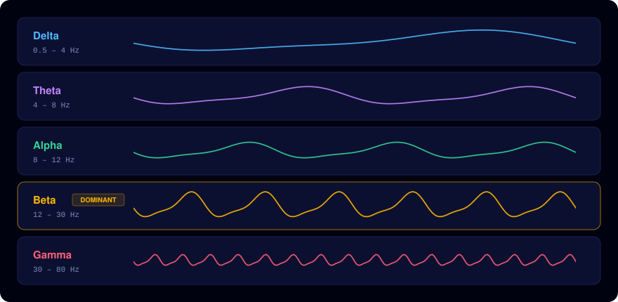
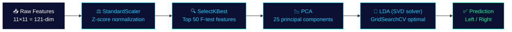

<div align="center">




**NEUROSCIENCE × MACHINE LEARNING × ASSISTIVE TECHNOLOGY**

# EEG Motor Imagery Classification for Wheelchair Control

A complete brain-computer interface pipeline that decodes imagined motor movements
into real-time directional commands — enabling hands-free wheelchair navigation
using a custom 5-formula LDA engine, high-density windowing, and live telemetry deployment.

**[▶ Open the full interactive page](https://abdulwaheedkhan003.github.io/Single-Channel-EEG-Spatial-Temporal-Augmentation-Signal-Conditioning-Framework/)**

</div>

---

## What This System Does

Translates raw brainwave signals into real-time wheelchair steering commands.
Motor imagery tasks (imagining left or right arm movement) create measurable beta-band
EEG patterns — this pipeline captures, filters, classifies, and deploys those patterns at 8 Hz inference speed.

<table>
<tr>
<td width="33%" valign="top">

### 🎯 Binary Motor Imagery Classification
Distinguishes Left Turn vs. Right Turn imagined movements using beta band (12–30 Hz) as the dominant discriminating feature via event-related desynchronisation.

</td>
<td width="33%" valign="top">

### ⚡ High-Density Sliding Window Engine
Segments 1-second windows with 8-sample step size, yielding a dense trial pool then doubled via controlled Gaussian noise augmentation for stable LDA training.

</td>
<td width="33%" valign="top">

### 📐 Manual 5-Formula LDA Engine
Full Fisher LDA derivation from scratch — scatter matrices, weight vectors, decision boundaries — implemented transparently in NumPy without blackbox wrappers.

</td>
</tr>
<tr>
<td valign="top">

### 📡 Real-Time Telemetry Deployment
Trained weights serialized to JSON and deployed as a live inference engine at 0.125-second ticks, outputting beta power in the physiological 5–45 μV² range.

</td>
<td valign="top">

### 🔬 GridSearchCV + PCA Optimization
StandardScaler → SelectKBest (top 50 F-test features) → PCA (25 components) → GridSearchCV over solver and shrinkage hyperparameters with 5-fold CV.

</td>
<td valign="top">

### 🔢 11×11 Feature Matrix Architecture
Five log-variance band features tiled into 121-element matrices, with Beta power scaled ×1.5 along the primary diagonal for discriminant emphasis.

</td>
</tr>
</table>

## 9-Step End-to-End Pipeline

From raw EEG acquisition to exported weights and real-time wheelchair steering output.



## EEG Frequency Band Decomposition

4th-order Butterworth bandpass filters split the continuous recording into five physiological bands.
Beta band is the primary wheelchair control signal — Event-Related Desynchronisation (ERD) during motor imagery.



## Optimized Classification Stack

Sequential preprocessing ensures numerical stability and maximum discriminant power before LDA training.



```python
# Optimized LDA pipeline with GridSearchCV
from sklearn.preprocessing import StandardScaler
from sklearn.feature_selection import SelectKBest, f_classif
from sklearn.decomposition import PCA
from sklearn.discriminant_analysis import LinearDiscriminantAnalysis
from sklearn.model_selection import GridSearchCV, StratifiedKFold, cross_val_score

scaler   = StandardScaler()
selector = SelectKBest(score_func=f_classif, k=50)
pca      = PCA(n_components=25)
lda      = LinearDiscriminantAnalysis()

param_grid = {"solver": ["lsqr", "eigen"], "shrinkage": ["auto", None]}
grid_search = GridSearchCV(lda, param_grid, cv=5, scoring="accuracy", n_jobs=-1)

X_train = pca.fit_transform(selector.fit_transform(scaler.fit_transform(X_train), y_train))
X_test  = pca.transform(selector.transform(scaler.transform(X_test)))
grid_search.fit(X_train, y_train)

cv_scores = cross_val_score(grid_search.best_estimator_, X_train, y_train,
                            cv=StratifiedKFold(n_splits=10), scoring="accuracy")
print(f"10-Fold CV: {cv_scores.mean()*100:.2f}% ± {cv_scores.std()*100:.2f}%")
```

## 5-Formula Manual LDA Engine

Full Fisher Linear Discriminant Analysis implemented from scratch in NumPy. Each formula resolves a distinct stage in the linear separation problem.

**1 · Class Mean Vectors**

$$\mu_k = \frac{1}{N_k} \sum_{x \in C_k} x$$

**2 · Regularized Within-Class Scatter Matrix**

$$S_W = \sum_k \sum_{x \in C_k} (x - \mu_k)(x - \mu_k)^{\top} + \alpha I$$

**3 · Between-Class Scatter Matrix**

$$S_B = \sum_k N_k \, (\mu_k - \mu_{\text{total}})(\mu_k - \mu_{\text{total}})^{\top}$$

**4 · Fisher Weight Vector and Bias**

$$w = S_W^{-1} (\mu_0 - \mu_1) \qquad w_0 = -\tfrac{1}{2} \, w^{\top} (\mu_0 + \mu_1)$$

**5 · Linear Decision Boundary Prediction**

$$f(x) = w^{\top} x + w_0 \qquad \hat{y} = \begin{cases} 0 \ (\text{Left}) & f(x) > 0 \\ 1 \ (\text{Right}) & \text{otherwise} \end{cases}$$

## Classification Results

Validated across three train/test splits with stratified partitioning and 10-fold cross-validation, consistently exceeding the 80% threshold.



## Real-Time Telemetry Stream

Live inference simulation at 0.125-second intervals. Beta power output clipped to physiological range 5–45 μV² for safe hardware command signals. Weights exported to JSON for embedded deployment.



## Tech Stack

Scientific Python ecosystem for end-to-end signal processing, machine learning, and visualization.


## Quick Start

Run the complete pipeline in Google Colab or a local Python 3 environment with your EEG data (Excel or CSV at 256 Hz).

```bash
# 1. Clone the repository
git clone https://github.com/Abdulwaheedkhan003/Single-Channel-EEG-Spatial-Temporal-Augmentation-Signal-Conditioning-Framework.git
cd Single-Channel-EEG-Spatial-Temporal-Augmentation-Signal-Conditioning-Framework

# 2. Install dependencies
pip install numpy pandas scipy scikit-learn matplotlib seaborn openpyxl jupyter

# 3. Run the notebook end-to-end
jupyter notebook EEG_FINAL.ipynb
```

```python
# Load your EEG data (Excel @ 256 Hz, single column)
import pandas as pd
raw_data = pd.read_excel("your_eeg_data.xlsx").values
```

Trained weights are exported to `high_accuracy_wheelchair_weights.json`:

```json
{"weights_vector": ["...121 floats..."], "bias_scalar": 0.0}
```

---

<div align="center">

### Open to International Opportunities

Available for AI/ML Engineering, BCI Research, Neurotech, and Assistive Technology roles.

[](https://github.com/Abdulwaheedkhan003)

<sub>EEG Motor Imagery BCI · Python & NumPy · Wheelchair Assistive Technology · © 2026</sub>

</div>
